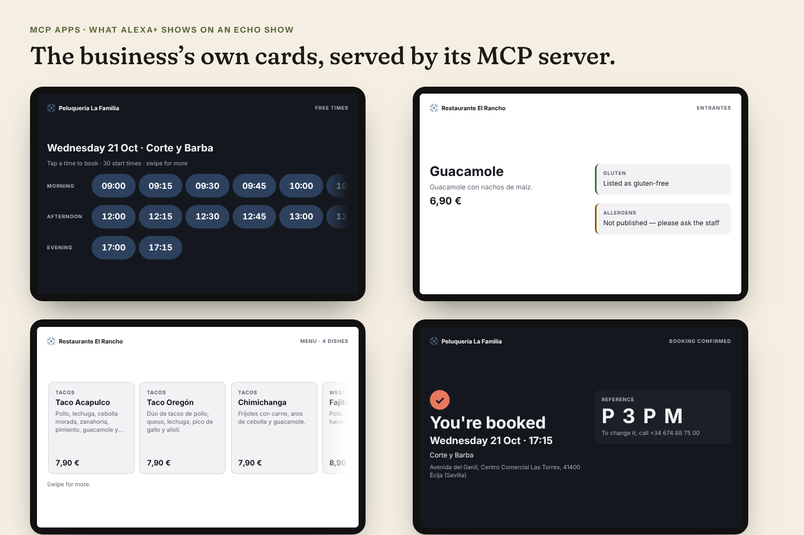
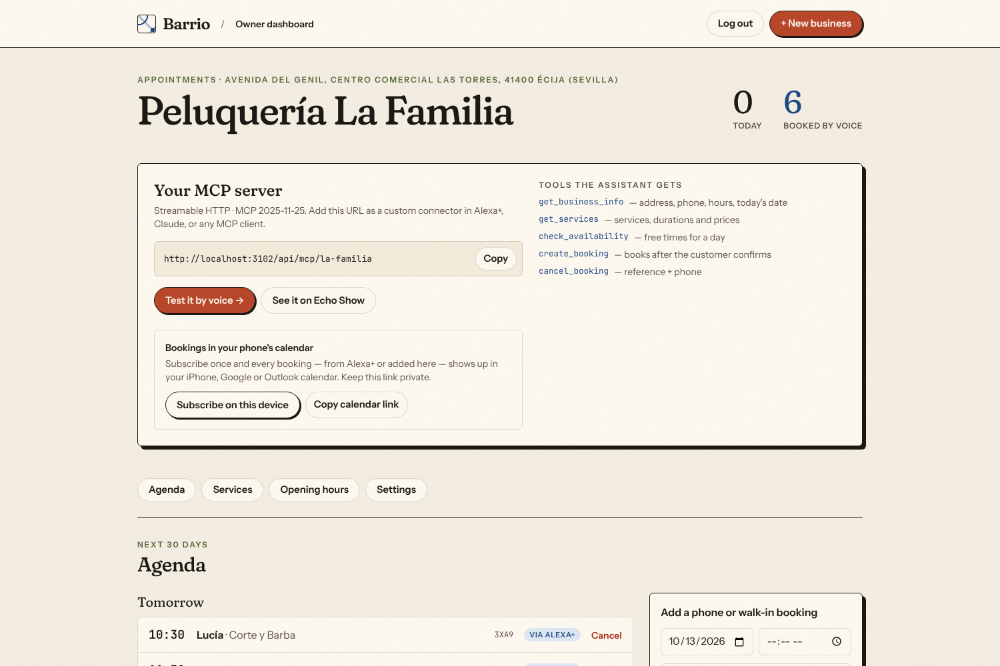
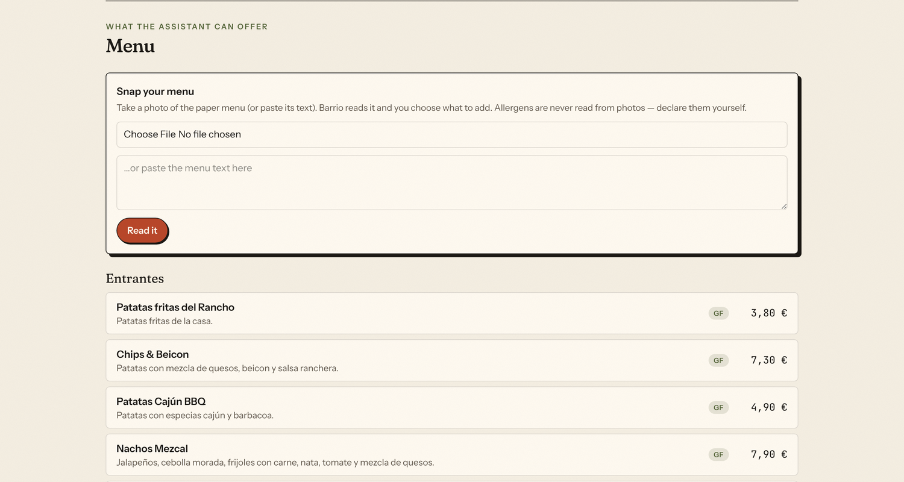
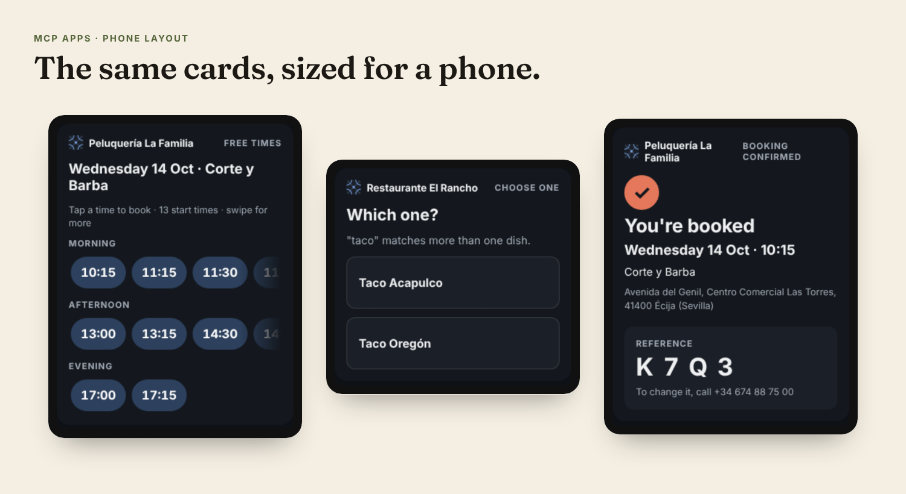

# Barrio — your neighbourhood on Alexa+

[](https://github.com/Miguelvv7/barrio/actions/workflows/ci.yml)
[](LICENSE)


**Barrio gives small local businesses an MCP server in five minutes**, so Alexa+ can answer their customers' questions and take bookings for them — no developers, no code. (The business's own MCP endpoint is live as soon as the form is saved; it joins the directory — the one add-on for the whole platform — once it's verified, so a stranger can't pose as a real shop.)

The barber round the corner and the Tex-Mex place on the high street will never build a voice integration, let alone get an Alexa+ add-on certified. With Barrio the owner fills in a form (or **takes a photo of the paper menu**) and gets a standards-based [MCP](https://modelcontextprotocol.io) server that speaks for the business — with **cards on Echo Show**, **bookings in the owner's phone calendar**, and a **directory endpoint designed to ship as one Alexa+ add-on for every shop on the platform**.

I built it for two real places in my town, Écija, in the south of Spain: my dad's Tex-Mex restaurant, where he answers the phone in the middle of the dinner rush, and the barber I go to, who takes bookings between haircuts (I built his website). Both are live in the demo, with their permission.

> Built for the **Amazon Developer "Build, Ship, Shape" hackathon — Alexa+ track**, following Amazon's [Alexa+ MCP Toolkit](https://developer.amazon.com/docs/alexaplus/add-ons/mcp-toolkit-overview.html) documentation.
> **Entry type:** my own MCP server (Streamable HTTP, spec 2025-11-25) **plus** a simulated Alexa+ experience in a web app.

**Live demo:** https://barrio-blush.vercel.app · try the voice simulator at [/try/la-familia](https://barrio-blush.vercel.app/try/la-familia) · Echo Show cards at [/try/el-rancho/screens](https://barrio-blush.vercel.app/try/el-rancho/screens)

**Demo video (2:54):** [youtu.be/HZodxXUT3yc](https://youtu.be/HZodxXUT3yc) — booking a table by voice at my dad's restaurant, end to end.

## Try it

| | |
|---|---|
| **Talk to it** | [/try/la-familia](https://barrio-blush.vercel.app/try/la-familia), [/try/el-rancho](https://barrio-blush.vercel.app/try/el-rancho) — a voice web app simulating Alexa+ (speech in/out, English/Spanish, or type); its MCP client calls `/api/mcp/<slug>` over Streamable HTTP. |
| **See the Echo Show cards** | [/try/el-rancho/screens](https://barrio-blush.vercel.app/try/el-rancho/screens), [/try/la-familia/screens](https://barrio-blush.vercel.app/try/la-familia/screens) — each card rendered by the business's MCP server with live data (the booking confirmation uses example data), no API key needed. |
| **Owner view** | [/dashboard/la-familia](https://barrio-blush.vercel.app/dashboard/la-familia) — read-only for visitors; create your own business at [/dashboard/new](https://barrio-blush.vercel.app/dashboard/new) and edit it. |
| **On a phone** | The same pages work on a phone; the Echo Show panel switches to the cards' phone layout. |
| **Any MCP client** | `POST /api/mcp` (all businesses) or `/api/mcp/<slug>` — e.g. `npx @modelcontextprotocol/inspector` → Streamable HTTP. |

```bash
curl -s https://barrio-blush.vercel.app/api/mcp -H 'content-type: application/json' \
  -H 'accept: application/json, text/event-stream' \
  -d '{"jsonrpc":"2.0","id":1,"method":"tools/call","params":{"name":"find_businesses","arguments":{"query":"tacos"}}}'
```

**What's real and what's simulated**

- **Real:** the MCP server, the booking engine, the database, the owner dashboard and the Echo Show cards, all running. The two businesses are real shops in Écija, Spain, used with their owners' permission — **Peluquería La Familia** (barber) and **Restaurante El Rancho** (Tex-Mex, my dad's restaurant) — seeded with the services, menu and prices they publish. This is a demo, so bookings made here **aren't sent to them**.
- **Simulated:** Alexa+ itself, in the browser, as the track allows (the Alexa+ MCP Toolkit isn't available to entrants, per the hackathon FAQ). A Claude agent plays the assistant through a real MCP client that sends `initialize`, `tools/list`, `tools/call` and `resources/read` over **Streamable HTTP** to the business's public endpoint — the same one an add-on would use — and it can only use the tools it discovers there. Each reply shows its MCP calls.

> **Opening hours matter when you test bookings:** La Familia takes appointments Monday to Friday; El Rancho takes tables Thursday to Sunday. On other days the assistant says it's closed and offers the next open day.



---

## What it does



| For customers (via Alexa+) | For owners (dashboard) |
|---|---|
| "How much is a haircut and beard trim?" — English aliases for Spanish service names | **Snap your menu**: photo or pasted text → reviewed dishes/services |
| "Anything free tomorrow after five?" — tap a time on Echo Show to book it | Services/menu, prices, gluten-free and declared allergens |
| "Which dishes are gluten-free?" — only what the restaurant says, never guessed | Opening hours with split shifts, capacity (chairs/tables) |
| "Is the taco gluten-free?" — *which one?* The card shows the options to tap | Live agenda tagged **via Alexa+**; phone and walk-in bookings |
| "A table for four on Friday at nine." — read back, booked only after a yes | **Calendar subscription** (iPhone/Google/Outlook) and email alerts |
| Optional email confirmation with a self-service cancel link | "Also called" names customers use in English, per service |





## For Alexa+

Built to the toolkit's documented requirements — checklist in [`alexa/README.md`](alexa/README.md):

- **Streamable HTTP, MCP 2025-11-25** (also negotiates 2025-06-18 and 2025-03-26, which Alexa+'s client sends), stateless so it scales on serverless.
- **Every tool declares an `outputSchema` and returns `structuredContent`**, validated by the official MCP client in tests.
- **MCP Apps on Echo Show**: every tool links `ui://barrio/card-<hash>.html` (`text/html;profile=mcp-app`) — one self-contained ~26 KB file, versioned by content hash, light/dark, English or Spanish from the host's `locale` (labels, plus the owner's English descriptions when written; names stay as the business wrote them), authored on Amazon's 768×480 base canvas and fitted to any screen, with its own layout for phones. Tapping a time, a dish or one of the "which one?" options sends `ui/message` back to Alexa.
- **"Still working" messages** via `_meta.ui.invoking` / `invoked`; tool annotations (`readOnlyHint`, `destructiveHint`, `idempotentHint`).
- **Fast**: ~5–10 ms server time per call (measured locally), read-through cache for business/catalog data, `Server-Timing` header, functions pinned to `iad1` next to the database.
- **Optional OAuth 2.1** `client_credentials` with RFC 8414 + RFC 9728 metadata (accepted by the official MCP SDK client) and bare `401`s, for a private-server add-on.
- **Store kit**: privacy policy, terms, icons in all six sizes, logos (SVG + PNG, light/dark), carousel and banner images — generated from code (`npm run build:assets`) — plus a listing generator that checks Amazon's field limits.

### Two endpoints

| Endpoint | What |
|---|---|
| `POST /api/mcp` | **Directory** — one server (one Alexa+ add-on) for every verified business: `find_businesses` + every tool with a `business` argument. "Alexa, ask Barrio for a haircut at La Familia." |
| `POST /api/mcp/<slug>` | One business's own server, for a business that wants its own add-on name. |

### Tools

| Tool | Salon | Restaurant | Notes |
|---|:-:|:-:|---|
| `find_businesses` | directory | directory | By need, name, or what a business actually sells, English or Spanish ("barber", "tacos", "restaurante para cenar", "guacamole", "beard trim", "gluten free"). Only verified businesses. |
| `get_business_info` | ✓ | ✓ | Address, phone, hours, booking rules and the business's **local date/time** (resolves "next Friday"). |
| `get_services` | ✓ | | Duration, price, `price_is_minimum`, ids and English aliases. |
| `get_menu` | | ✓ | By category, searchable, accent-insensitive; "gluten free" / "sin gluten" lists the dishes the restaurant flags gluten-free. |
| `check_dish` | | ✓ | Gluten-free only when the restaurant says so; allergens only when declared — otherwise "ask the staff". If other dishes match what was said ("tacos with guacamole", "taco"), it asks which one. |
| `check_availability` | ✓ | ✓ | Start times + compact ranges to read aloud, optionally narrowed to a time of day (`after` / `before`: "after five" → from 17:00, on the server); next free days when full, closed or already past at the business. |
| `create_booking` | ✓ | ✓ | Atomic capacity check (peak tables/chairs in use); nearest alternatives on both sides of a split shift; a retried request returns the same booking; 4-character reference with no look-alike characters; optional email confirmation. |
| `cancel_booking` | ✓ | ✓ | Reference **and** phone; only bookings that haven't started; a retried cancel says "already cancelled". |

Voice-friendly inputs: `today`, `tonight`, `tomorrow`, `mañana`, `this monday`, `el próximo viernes`; `17:30`, `5:30pm`, `noon`, `half past five`, `a las 17:30` — and "8:30" at a restaurant whose 08:30 is closed means 20:30; "corte con barba" → *Corte y Barba*, "beard trim" → *Arreglo de barba*.

## Architecture

```
Alexa+ / any MCP client ──POST──▶ /api/mcp            directory server (verified businesses)
                          └─POST─▶ /api/mcp/<slug>     one business
                                        │
               McpServer: tools (outputSchema + structuredContent) · MCP App resource · profile resource
                                        │
                               BookingService ── availability.ts (pure booking rules)
                                        │                     └─ hooks → emails (after the response)
                   CachedStore ─ SupabaseStore ── Postgres: create_booking_atomic() (advisory lock)
                   MemoryStore (local dev / tests, zero config)

Owner   ─▶ /dashboard/<slug>   server actions · menu import (Claude vision, structured outputs) · calendar feed (.ics)
Visitor ─▶ /try/<slug>         voice UI → /api/assistant/<slug> → Claude ⇄ MCP client ──Streamable HTTP──▶ /api/mcp/<slug>
                               Echo Show panel = MCP Apps host (AppBridge) rendering the server's UI
```

**Stack:** Next.js 16 · TypeScript · `@modelcontextprotocol/sdk` 1.32 · `@modelcontextprotocol/ext-apps` (MCP Apps) · Supabase (Postgres) · Tailwind CSS 4 · Anthropic SDK (Claude Haiku 5.5 for the simulator, Claude Sonnet 5.5 for menu photos) · Vitest · Playwright.

## Reliability and security

- **No double bookings**: `create_booking_atomic()` takes a per-business advisory lock, re-counts the peak number of bookings in use against capacity, enforces the per-phone limit and an hourly ceiling on assistant bookings (20 for sandbox businesses; `max(20, min(capacity, 20) × 6)` for verified ones) so a script with fake numbers can't fill weeks of agenda. Owner bookings are never blocked. A retried request (same phone, time and service or party size) gets the booking it already made.
- **Sandbox vs verified businesses**: anyone can create a business to try Barrio (rate-limited per IP), but only businesses created by the admin are verified: only they appear on the public pages and in the directory (so a sandbox named like a real shop can't take its bookings), only they send email, and only the admin can switch on owner email alerts. Emails are also capped per recipient and per hour.
- **Cancellation**: needs the reference and the phone; five wrong references lock that phone out for 15 minutes, on the web form and over MCP. There's deliberately no business-wide lock, which would let anyone block every customer's cancellation.
- **MCP endpoint**: `Origin` validation (403), CORS only for allowed origins, 64 KB body cap enforced while streaming, batches rejected, unsupported `MCP-Protocol-Version` → 400, Zod schemas with length limits everywhere. Unexpected failures come back as a short "try again or call" message — never raw database text.
- **Database**: Row Level Security on every table with no policies — the anon key reads nothing. Service-role key server-side only. Bookings deleted 12 months after the appointment (Vercel Cron).
- **Dashboard**: read-only for visitors with customer names reduced to initials; owner login (httpOnly cookie bound to the current password, constant-time checks, failed attempts capped per IP, redirects limited to `/dashboard…`), fail-closed in production without a password; per-business ownership via HMAC-signed cookie; every server action re-checks permissions; destructive actions ask first.
- **Production configuration fails loudly**: on Vercel the app refuses to run without `BARRIO_SECRET` (signing never falls back to the admin password), and in production without Supabase (in-memory bookings per instance would lose data) unless `BARRIO_ALLOW_MEMORY_STORE=1` is set on purpose.
- **AI endpoints**: the simulator requires a same-site `Origin` and a short-lived signed page token, with per-IP limits, bounded timeouts and a fixed system prompt per request; menu import uses structured outputs, sniffs real image bytes, caps size, treats menu content as data, never extracts allergens, and refuses a cut-off answer instead of showing half a menu. Hard spend cap: the Anthropic console.
- **Emails**: HTML-escaped, sent after the response so they never touch the assistant's latency.
- **Calendar feed**: secret per-business URL; RFC 5545 escaping with control characters stripped (no injected events).

Rate limits that live in memory (login, cancellation lockout, email caps, simulator) are per server instance; the booking ceilings and capacity are enforced in Postgres and hold across instances.

## Testing

```bash
npm test              # 335 unit, protocol, concurrency and fuzz tests (+11 Supabase tests when SUPABASE_TEST_* is set)
npm run typecheck && npm run lint
npm run test:sql      # DATABASE_URL=<disposable Postgres> — migration (twice) + 21 checks incl. 100 concurrent bookings
npm run test:e2e      # 71 browser checks (setup in e2e/run.mjs)
npm run load-test -- http://localhost:3000 la-familia   # add --no-race against a real deployment to skip test bookings
```

[CI](.github/workflows/ci.yml) runs the 335 tests, the Postgres concurrency test (real Postgres service) and the browser suite (Chromium) on every push to `main` and every pull request. The 11 Supabase tests (through PostgREST, like Supabase itself) and the load test run against a database/deployment you point them at.

- **Protocol**: version negotiation, 202/405/403/406/400/413/404 behaviour, output schemas validated by the official client, OAuth metadata validated by the SDK's own schemas, MCP App resource, directory server.
- **100 simultaneous customers**: one barber slot → exactly 1 booking and 99 alternatives; 100 table requests → exactly 8 (capacity); peak-capacity counting; three identical requests → one booking; random chaos never overbooks; one phone spamming parallel requests gets at most 3; hourly flood ceiling — across the in-memory store, real PostgreSQL (100 concurrent bookings over a 30-connection pool), and through PostgREST (Supabase tests, incl. agendas over 1,000 bookings).
- **Fuzzing**: 3,000 calls with hostile inputs → never a 5xx, never a malformed booking.
- **Voice behaviour**: answers about the dish or service actually asked for, gluten-free filters, English aliases, date/time phrases, a US evening that's already tomorrow in Spain, DST in Madrid, lunch breaks, closing time, minimum notice, grid alignment.
- **Claude**: the fake model in the tests returns real-shaped responses (thinking blocks, `max_tokens`/`refusal` stop reasons, structured-output JSON) to catch what only the real API does.
- **Features**: OAuth (signature, expiry, audience, `alg:none`, malformed credentials), calendar feed (UTC across DST, RFC 5545 escaping/folding, CR injection), emails (escaping, failure isolation, sandbox/recipient caps), cancel lockout, menu import, retention, cache invalidation, production config checks.
- **Browser**: onboarding a business and querying it over MCP, Echo Show cards rendered by the official host (taps on a time and on a "which one?" option send `ui/message` back), self-cancel, calendar feed, read-only mode and forged submissions, login/open-redirect attempts, no horizontal scroll at 375/768 px.

Load test against the live deployment (Vercel `iad1` + Supabase us-east-1, measured from Spain, so every call crosses the Atlantic): sequential round trips **p50 150 ms / p95 222 ms** once warm; 2,000 calls with 100 in flight → **0 errors**. Locally (production build, one Node process): p50 6 ms / p95 11 ms.

## Run it locally

```bash
npm install
npm run dev           # http://localhost:3000 — in-memory demo data, everyone is admin
```

`.env.local` with `ANTHROPIC_API_KEY` enables the voice simulator and menu import. Every app variable is listed in [`.env.example`](.env.example); the test-only ones are next to the commands below.

## Deploy (Vercel + Supabase)

1. Create a Supabase project in **us-east-1**. In the SQL editor, run `supabase/migrations/0001_barrio.sql`.
2. Copy `.env.example` to `.env.local`, set `SUPABASE_URL` and `SUPABASE_SERVICE_ROLE_KEY`, then `npm run seed`.
3. Import the repo in Vercel and set the variables from `.env.example` (at least `SUPABASE_*`, `BARRIO_ADMIN_PASSWORD`, `BARRIO_SECRET`, `ANTHROPIC_API_KEY`, `CRON_SECRET`). Functions run in `iad1` (`vercel.json`).
4. Deploy. MCP: `https://<project>.vercel.app/api/mcp` (all businesses) and `/api/mcp/<slug>`.
5. Publishing on Alexa+: [`alexa/README.md`](alexa/README.md).

Upgrading a database created before English descriptions existed: re-run the migration (it's idempotent), or just its three `description_en` lines, then `npm run seed:english` to load the demo businesses' English texts.

## Data notes

- La Familia's services, prices, durations and hours and El Rancho's dishes, prices and gluten-free list come from each business's own website. Owners can add an English description to the business, each service and each dish (Alexa+ speaks English); the demo's English texts are straight translations of the businesses' Spanish ones. El Rancho's opening hours aren't published online; they come from the owner.
- Two El Rancho burgers whose real names are a brand and a person's name appear under generic names (same dishes and prices), so the demo carries no third-party marks.
- Per-dish allergens are left undeclared for El Rancho because the restaurant doesn't publish them; the assistant says so instead of guessing.

## Open-source spin-off

The Echo Show card work is also available on its own, MIT-licensed, for anyone building an Alexa+ add-on: [**echo-show-mcp-app-starter**](https://github.com/Miguelvv7/echo-show-mcp-app-starter) — an MCP server with one self-contained card per tool, a phone layout and a local preview host.

## Hackathon write-ups

[Product feedback](docs/PRODUCT_FEEDBACK.md) · [Friction log](docs/FRICTION_LOG.md) · [Feature requests](docs/FEATURE_REQUESTS.md) · [Video transcript](docs/VIDEO_SCRIPT.md)

## License

MIT © 2026 Miguel Victorio
