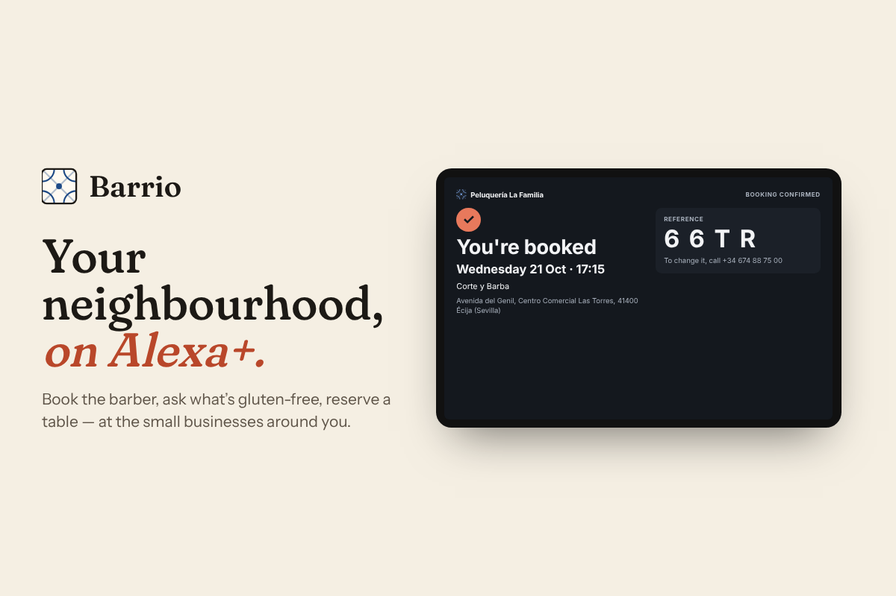

# Barrio — your neighbourhood on Alexa+

[](https://github.com/Miguelvv7/barrio/actions/workflows/ci.yml)
[](LICENSE)



**Barrio gives small local businesses an MCP server in five minutes**, so Alexa+ (or any MCP-capable assistant) can answer customers' questions and take bookings for them — no developers, no code.

The barber round the corner and the Tex-Mex place on the high street will never build a voice skill. With Barrio, the owner fills in a form (services or menu, prices, opening hours, how many chairs or tables) and gets back **one URL**: a standards-based [MCP](https://modelcontextprotocol.io) server that speaks for that business.

> Built for the **Amazon Developer "Build, Ship, Shape" hackathon — Alexa+ track**.
> Demonstrated with two real businesses in Écija, Spain: **Peluquería La Familia** (barber) and **Restaurante El Rancho** (Tex-Mex), using their own published services, menu and prices.

---

## What it does

| For the customer (via Alexa+) | For the owner (dashboard) |
|---|---|
| "How much is a haircut and beard trim?" | Edit services / menu, prices, durations |
| "Anything free tomorrow after five?" | Opening hours with split shifts (lunch breaks) |
| "Is the guacamole gluten-free?" | Capacity: chairs or tables in parallel |
| "Book a table for four on Friday at nine." | Live agenda: who booked, when, and whether it came **via Alexa+** |
| "Cancel booking K7Q3." | Add phone / walk-in bookings (no notice period, phone optional), cancel bookings |

## The MCP server

Every business gets its own endpoint:

```
POST https://<your-deployment>/api/mcp/<business-slug>
```

- **Transport:** Streamable HTTP, **MCP spec 2025-11-25** (also negotiates 2025-06-18 and 2025-03-26).
- **Stateless:** each POST gets a fresh server + transport, so it scales horizontally on serverless (Vercel) with no sticky sessions. `GET`/`DELETE` return `405`, as the spec allows for servers that don't offer an SSE stream.
- **Multi-tenant:** one deployment, any number of businesses; each tenant only exposes the tools that make sense for it.
- **Server instructions** tell the assistant the booking flow: check → read details back → explicit "yes" → book → read back the reference.

### Tools

| Tool | Salon | Restaurant | Notes |
|---|:-:|:-:|---|
| `get_business_info` | ✓ | ✓ | Address, phone, hours, booking rules and the business's **local date/time** (so "next Friday" resolves correctly). |
| `get_services` | ✓ | | Services with duration and price. Searchable. |
| `get_menu` | | ✓ | Menu by category, searchable, accent-insensitive. |
| `check_dish` | | ✓ | Price, gluten-free status, allergens. **Never guesses:** if the restaurant hasn't declared allergens, the tool says so and tells the customer to ask staff. |
| `check_availability` | ✓ | ✓ | Free start times + compact ranges to read aloud. If the day is full/closed, suggests the next days with space. |
| `create_booking` | ✓ | ✓ | `readOnlyHint: false`. Re-checks capacity atomically; if someone took the slot a moment ago, returns the nearest alternatives. Returns a 4-character reference with no ambiguous characters (no 0/O, 1/I, 5/S…). |
| `cancel_booking` | ✓ | ✓ | `destructiveHint: true`. Needs the reference **and** the phone number used to book. |

Inputs are built for voice: dates accept `YYYY-MM-DD`, `today`, `tomorrow`, `mañana`, weekday names in English or Spanish; times accept `17:30`, `5:30 pm`, `5:30pm`, `1730`; service names are fuzzy-matched ("corte con barba" → *Corte y Barba*), and ambiguous ones ("corte") make the tool ask instead of guessing.

### Connect it

- **Alexa+:** point your Alexa+ MCP integration at this URL (Streamable HTTP, no auth needed for the demo tenants).
- **Claude / any MCP client:** add it as a remote MCP server (Streamable HTTP).
- **MCP Inspector:** `npx @modelcontextprotocol/inspector`, transport *Streamable HTTP*, URL above. (If you use a hosted Inspector in the browser, add its origin to `BARRIO_ALLOWED_ORIGINS`.)

### Alexa+ simulator

`/try/<business-slug>` is a voice web app that simulates the Alexa+ experience: speech recognition in, speech synthesis out, English or Spanish. Behind it, a Claude agent whose **only** tools are the ones it discovers from the business's MCP server (`tools/list` → `tools/call`). It holds no business data of its own, so every price, time and allergen it says came through MCP. Each reply shows an expandable "MCP calls" trace.

## Architecture

```
Alexa+ / MCP client ──POST──▶ /api/mcp/[slug]  (Streamable HTTP, stateless)
                                   │
                         McpServer per tenant (tools)
                                   │
                            BookingService  ← pure booking rules (availability.ts)
                                   │
                    Store ─┬─ SupabaseStore (production) ── Postgres: create_booking_atomic()
                           └─ MemoryStore   (local dev / tests, zero config)

Owner ──▶ /dashboard/[slug]  (Next.js server actions → same Store)
Visitor ─▶ /try/[slug]       (voice UI → /api/assistant → Claude ⇄ in-memory MCP client)
```

**Stack:** Next.js 16 (App Router) · TypeScript · `@modelcontextprotocol/sdk` 1.32 · Supabase (Postgres) · Tailwind CSS 4 · Anthropic SDK (simulator only) · Vitest.

### No double bookings — even with 100 people at once

Capacity is enforced where it can't race:

- **Postgres:** `create_booking_atomic()` takes a per-business transaction-scoped advisory lock, re-counts overlapping confirmed bookings against the stored capacity, enforces the per-phone limit, then inserts. Two customers asking for the last slot at the same instant cannot both get it.
- **In-memory store:** the check and the insert run with no `await` in between.

## Security

- **MCP endpoint:** `Origin` validation (403 on foreign browser origins — DNS-rebinding protection required by the spec), CORS only for allowed origins, 64 KB body cap (enforced while streaming, not just via `Content-Length`), JSON-RPC batches rejected, unsupported `MCP-Protocol-Version` → 400, strict Zod schemas with length limits on every argument.
- **Abuse limits (enforced atomically in the database):** max 3 upcoming bookings per phone number per business, and a per-business ceiling on assistant bookings per rolling hour (`max(20, capacity × 6)`) so a script with made-up phone numbers can't fill weeks of agenda. Plus a 60-day horizon, 30-minute minimum notice and a fixed start-time grid. When the ceiling trips, the assistant tells the customer to call the business; owner bookings are never blocked.
- **Privacy:** visitors to the read-only dashboard see initials only — no names, notes, phones or booking references.
- **Database:** Row Level Security on every table with **no** policies — the public anon key can read nothing. The app uses the service-role key, server-side only.
- **Dashboard:** visitors get a read-only view (so demo data can't be wrecked during judging). The owner logs in with `BARRIO_ADMIN_PASSWORD` (httpOnly, SameSite=Lax cookie bound to the current password, constant-time comparison, redirects restricted to `/dashboard…` paths). In production without a password the dashboard fails closed: nobody is admin. Anyone can create their own sandbox business and edit only that one (HMAC-signed ownership cookie). Every server action re-checks permissions on the server.
- **Simulator endpoint (paid LLM):** requires a same-site `Origin` and a short-lived HMAC token embedded in the `/try` page, best-effort per-IP and per-instance rate limits, conversation size caps and bounded tool-call rounds. These raise the bar; the hard guarantee is a monthly spend limit in the Anthropic console.
- Security headers: `X-Content-Type-Options`, `X-Frame-Options: DENY`, `Referrer-Policy`, `Permissions-Policy`.

## Testing

```bash
npm test              # 142 unit/integration tests (+8 Supabase tests when SUPABASE_TEST_* is set)
npm run typecheck
npm run lint
npm run test:sql      # DATABASE_URL=<disposable Postgres> — migration + 100 concurrent bookings
npm run test:e2e      # browser tests (see e2e/run.mjs for setup)
npm run load-test -- http://localhost:3000 la-familia
```

What the suite covers:

- **Protocol compliance:** initialize/version negotiation, `202` for notifications, `405` for GET/DELETE, `403` foreign origin, `406` bad `Accept`, `400` bad protocol version / malformed JSON / batches, `413` oversized bodies (with and without `Content-Length`), `404` unknown tenant. Also checked with the official MCP Inspector CLI.
- **100 simultaneous customers:** 100 parallel bookings for one barber slot → exactly 1 succeeds and 99 get alternatives; 100 table requests → exactly 8 (the capacity); random chaos across days/services never overbooks and every reference is unique; one phone spamming 50 parallel requests gets at most 3 bookings; 100 concurrent MCP clients over the real protocol; hourly flood ceiling.
- **Fuzzing:** 3,000 random calls with hostile inputs (SQL/HTML injection strings, unicode tricks, huge numbers, wrong types, prompt-injection text) → never a 5xx, always valid JSON-RPC, never a malformed booking.
- **Voice-facing behaviour:** ambiguous dishes or services make the tool ask instead of guessing; "5:30pm", "el próximo viernes", "this monday"; off-grid times rejected with alternatives; lunch breaks, closing time, closed days, past dates, minimum notice, DST change in Madrid (25 Oct 2026), local-midnight rollover.
- **Database layer:** `npm run test:sql` runs the migration and `create_booking_atomic()` on real PostgreSQL with 100 concurrent connections; `tests/supabase-store.test.ts` runs `SupabaseStore` end-to-end through PostgREST (as Supabase does), including RLS blocking the anon key. Both were run against PostgreSQL 16 + PostgREST 12 during development.
- **Browser end-to-end** (`e2e/run.mjs`, 51 checks): onboarding a new business and querying it over MCP, editing prices (visible to MCP immediately), validation errors, conflicting bookings, cancellations, read-only mode with masked customer data, forged server-action submissions, tampered cookies, login/logout, open-redirect attempts, no horizontal scroll at 375 px and 768 px.

Load test against a production build (single Node process): **2,000 MCP calls with 100 in flight → 0 errors, p50 ≈ 350 ms, p95 ≈ 480 ms.**

## Run it locally

```bash
npm install
npm run dev           # http://localhost:3000 — runs on the in-memory demo store
```

Open `/` → pick a business → **Owner view** or **Try it by voice** (the simulator needs `ANTHROPIC_API_KEY` in `.env.local`).

## Deploy (Vercel + Supabase)

1. Create a Supabase project. In **SQL Editor**, run `supabase/migrations/0001_barrio.sql`.
2. Copy `.env.example` to `.env.local`, fill in `SUPABASE_URL` and `SUPABASE_SERVICE_ROLE_KEY`, then load the demo businesses: `npm run seed`.
3. Import the repo in Vercel and set the environment variables from `.env.example` (`SUPABASE_*`, `BARRIO_ADMIN_PASSWORD`, `BARRIO_SECRET`, `ANTHROPIC_API_KEY`).
4. Deploy. Your MCP URLs are `https://<project>.vercel.app/api/mcp/la-familia` and `/api/mcp/el-rancho`.

> Without Supabase the app still runs, but each serverless instance would have its own in-memory data — fine for local development, not for production.

## Data notes

- Services, prices, durations and opening hours for Peluquería La Familia, and dishes, descriptions, prices and the gluten-free list for Restaurante El Rancho come from each business's own website.
- El Rancho doesn't publish opening hours online; the hours in the demo are a placeholder.
- Per-dish allergens are intentionally left **undeclared** for El Rancho because the restaurant doesn't publish them. The assistant says so and points customers to the staff — it never invents allergen information.

## License

MIT © 2026 Miguel Victorio
